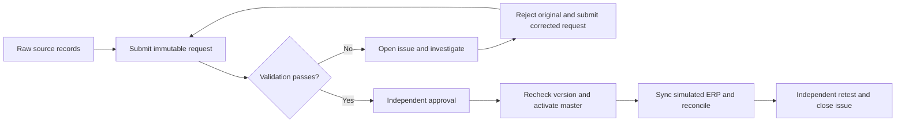
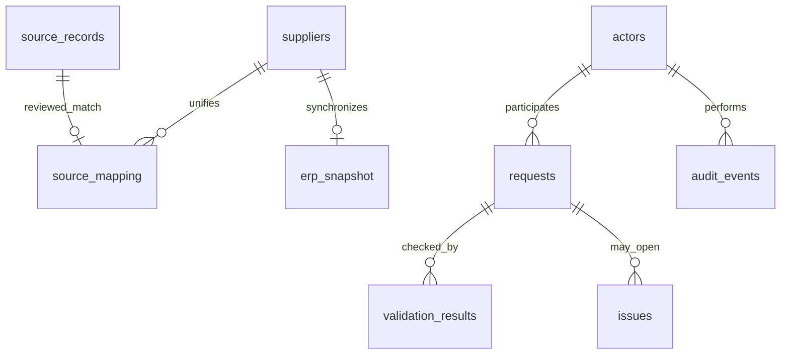

# Supplier Master Data Governance Simulation

A small, runnable Python + SQLite project that takes supplier data from raw source records to approved master data, a simulated ERP snapshot, and a traceable exception-resolution record.

**Learning simulation · synthetic data · Python standard library only**

This project explores how data cleaning becomes part of a governed business process. It includes validation, human match decisions, independent approval, version checks, change history, reconciliation and issue closure. It does not connect to SAP, Informatica, Reltio, a bank, or a real ERP.

Start with [the sample results](SAMPLE_RESULTS.md) or the [beginner's guide](LEARNING_GUIDE.md).

## Quick start

Requirements: Python 3.9+ with SQLite JSON1 support. No pip packages, server, credentials or internet connection are needed. Verified locally with Python 3.9.6.

Download this repository with **Code → Download ZIP**, unzip it, and open a terminal in the project folder. Or clone it:

```bash
git clone https://github.com/Riccia-Liang/data_governance.git
cd data_governance
python3 demo.py
python3 -m unittest -v
```

On Windows, use `py demo.py` and `py -m unittest -v` if `python3` is unavailable.

The demo creates a new `runs/<UTC timestamp>/` directory containing:

- `report.md`: the readable walkthrough and measured results.
- `results.json`: duplicate candidates, blocked attempts and monitoring snapshots.
- `governance.sqlite`: the full local database.
- Ten CSV exports: actors, raw sources, master suppliers, source mappings, requests, validation results, issues, audit events, ERP snapshot and sync attempts.

Each run has its own directory. To choose a location, run `python3 demo.py --output runs/my-first-run`. An existing output directory is refused to preserve earlier evidence. Generated run files are ignored by Git.

## Business scenario

Two fictional source systems contain eight records describing four suppliers. They include inconsistent spacing/case, a name variation, a missing tax identifier and a payment term outside the demo policy.

The initial load preserves every raw record. Basic normalization only changes spacing and case. Country/tax matches produce **candidates** for a steward to review; they never automatically merge records. The steward records a source-to-master mapping and explains which record was selected. Missing values and conflicting business values require investigation and a corrected request.

Once the initial suppliers are created, an approver requests a bank-token change. The model blocks that person's self-approval and requires another approver. After activation, reconciliation detects an outdated ERP snapshot. A simulated sync failure keeps the difference visible until a successful retry.

Tax identifiers (`SYN-CN-1001`) and bank tokens (`DEMO-0001`) are deliberately fictional. Their format rules are invented for this project and are not country-specific tax or banking validation.

## Workflow



Request states: `SUBMITTED → VALIDATED → APPROVED → APPLIED`. A failed validation becomes `VALIDATION_FAILED`; submitted, failed or validated requests can be rejected. Proposals cannot be edited after submission: corrections create new requests and preserve the originals.

Issue states: `OPEN → INVESTIGATING → REMEDIATED → CLOSED`. Closing an issue requires an applied replacement for the same supplier, a fresh validation and agreement with the ERP snapshot.

| Actor | Simulated role | Main responsibility |
|---|---|---|
| Alice | Requester | Submit supplier requests |
| Bob | Data steward | Validate, investigate, activate, map sources and sync |
| Carol | Approver | Review requests and independently close issues |
| Diana | Approver | Approve Carol's bank-change request |

Every known actor may submit a request. Only a steward may validate/apply/sync; only an approver may approve. Requester and validator cannot approve that request. These are checks on supplied actor names, **not authentication**.

## Example results

The included scenario produces these results; [SAMPLE_RESULTS.md](SAMPLE_RESULTS.md) was generated by running the code:

| Measure | Result |
|---|---:|
| Raw source records / master suppliers | 8 / 4 |
| Reviewed source mappings | 8 |
| Duplicate candidate groups | 3 |
| Applied / rejected requests | 5 / 2 |
| Rule-level issues opened / closed | 3 / 3 |
| Deliberately blocked actions | 5 |
| Simulated failed sync attempts | 1 |
| Final approval exceptions / ERP mismatches / open issues | 0 / 0 / 0 |

Northstar's missing tax value fails both the required-field and tax-format checks, creating two rule-level issues. Cedar's invalid payment terms create the third. Three candidate groups are found because the source row with a missing tax value cannot form an exact tax match. Its eventual mapping is an explicit simulated human decision.

Zero final exceptions describes this tiny scripted dataset only. Historical failures remain visible; it is not a claim of production control effectiveness or a data-quality improvement percentage.

## Cleaning, EDA and governance

| Activity | Main question | Example in this project |
|---|---|---|
| Data cleaning | How should an observed value be standardized or corrected? | Trim spaces and normalize `cn` to `CN` |
| Exploratory data analysis | What patterns, distributions and anomalies exist? | Count missing tax values or inspect duplicate candidates |
| Data governance | Who defines a valid value, authorizes a change and owns the outcome? | Require an allowed payment term, independent approval and evidence of resolution |
| Master data management | Which trusted supplier record should systems share? | Map two source IDs to one master ID and reconcile it with the ERP snapshot |

These activities overlap. Cleaning and EDA help identify and understand problems; governance adds policies, ownership, decisions and evidence that persist after analysis.

## Files to read

| File | Purpose |
|---|---|
| [demo.py](demo.py) | Readable, end-to-end business scenario; start here |
| [governance.py](governance.py) | Validation, workflow, roles, source mapping, synchronization and issue methods |
| [schema.sql](schema.sql) | Tables, keys, uniqueness and history-protection triggers |
| [monitoring.sql](monitoring.sql) | Executed SQL checks for approvals, field-level ERP reconciliation and open issues |
| [source_suppliers.csv](source_suppliers.csv) | Eight deliberately imperfect synthetic records |
| [data_dictionary.csv](data_dictionary.csv) | Table and field meanings |
| [validation_rules.csv](validation_rules.csv) | Eight quality/control checks and their limits |
| [risk_control_matrix.csv](risk_control_matrix.csv) | Risks, control actions, owners, frequency and evidence |
| [test_governance.py](test_governance.py) | Sixteen scenario tests including negative cases |
| [LEARNING_GUIDE.md](LEARNING_GUIDE.md) | Simple explanation, walkthrough and practice questions |

The files are kept in one folder to make the project easy to navigate. CSV, JSON and Markdown outputs can be read without a BI tool.

## Data model



A CREATE request can exist before its supplier does, so its supplier ID intentionally has no database foreign key. Application logic checks that the target exists for UPDATE and is absent for CREATE. Approval and activation recheck the master version and uniqueness inside a SQLite write transaction, preventing a stale proposal from overwriting a newer record.

## Try a small change

1. Run the demo and open the generated `report.md`.
2. Find the bank change in `demo.py` and change `DEMO-9001` to `DEMO-9002`.
3. Run it again. Compare `requests.csv`, `audit_events.csv` and `erp_snapshot.csv` between the two runs.
4. Read `test_bank_change_requires_verification_reference` in the tests to see what happens when the evidence reference is absent.

The scripted demo expects its documented fixture. Experiments that change fixture validity may deliberately stop an assertion; use tests or a separate scenario rather than silently changing the expected result.

## Scope and limitations

- This is an AI-assisted learning portfolio project, not a deployed enterprise solution or employment experience.
- Actor names and verification references are simulated. A nonempty `SIM-CALLBACK-001` reference does not prove that a real callback occurred.
- Match review and field selection are explicit scenario decisions. There is no fuzzy matcher, automated survivorship engine, source-system correction or upstream writeback.
- The ERP is a local snapshot table. No SAP/MDM configuration or network integration is performed.
- Audit triggers prevent accidental row updates/deletes. A database owner can bypass the application or remove triggers. Logs are not tamper-proof, access-controlled or retention-managed.
- Successful workflow actions are in `audit_events`; the demo records blocked attempts separately in `results.json`. There is no production security-event collection.
- Sync failures appear in the sync history and reconciliation results; they do not automatically create issue tickets. The issue workflow demonstrated here covers validation failures.
- Control checks illustrate selected concepts. They do not certify SOX compliance, establish audit scope or demonstrate controls operating over a real period.
- This is a single-machine teaching model. Authentication, authorization administration, durable external evidence, real ERP connectors and operational scheduling would require further design.

## Further reading

- [SAP Learning: Introducing Central Governance of Master Data](https://learning.sap.com/courses/introducing-sap-master-data-governance/introducing-central-governance-of-master-data) explains change requests and review/approval workflows. This project uses a deliberately simplified original workflow.
- [PCAOB AS 2201](https://pcaobus.org/oversight/standards/auditing-standards/details/AS2201), particularly .34-.45 and .50, provides context for control design, operation and evidence. This simulation is not an implementation of the auditing standard.

The project uses no company data, real bank information or proprietary system configuration.
